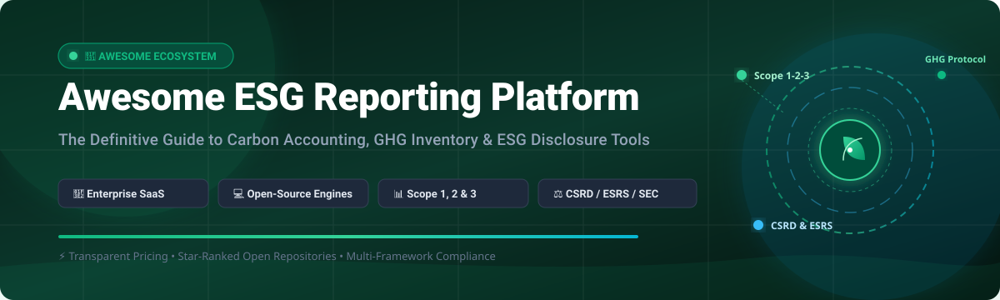
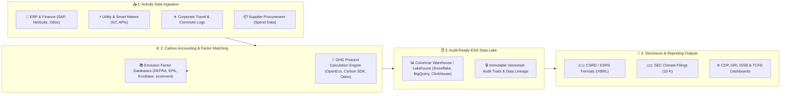

  

  
  
  
  
  
  
  

---

# 🌿 Awesome ESG Reporting Platform

> **The Definitive, Curated Directory of Enterprise SaaS Solutions, Open-Source Engines, GHG Protocol Calculators & Carbon Accounting Frameworks.**

*Accelerate your organization's sustainability journey with tools for **Scope 1, 2 & 3 Carbon Accounting**, **CSRD / ESRS Compliance**, **SEC Climate Disclosures**, **TCFD / ISSB Alignment**, and **Financed Emissions (PCAF)**.*

**📅 Last updated: August 2026**

---

## 📑 Table of Contents

- [🌟 Overview & Ecosystem](#-overview--ecosystem)
- [🏢 SaaS & Hosted Platforms](#-saashosted-platforms)
- [💻 Open-Source GitHub Projects](#-open-source-github-projects)
- [🏗️ Architectural Stack for ESG Reporting](#️-architectural-stack-for-esg-reporting)
- [📚 Key Frameworks & Regulatory Standards](#-key-frameworks--regulatory-standards)
- [🤝 How to Contribute](#-how-to-contribute)
- [📈 Star History](#-star-history)
- [⚖️ Disclaimer](#️-disclaimer)

---

## 🌟 Overview & Ecosystem

Accurate **ESG (Environmental, Social, and Governance) reporting** and **carbon accounting** have shifted from voluntary PR disclosures to mandatory regulatory compliance. From the European Union's **Corporate Sustainability Reporting Directive (CSRD / ESRS)** and the **US SEC Climate Disclosure Rules** to the **California Climate Corporate Data Accountability Act (SB 253 / SB 261)** and global **IFRS / ISSB** baselines, organizations require auditable, transparent data systems.

This curated repository tracks the leading **commercial enterprise SaaS solutions** (benchmarked by market valuation, revenue, transparent pricing, and free trial access) and top **open-source developer tooling** (ranked by GitHub community adoption).

---

## 🏢 SaaS/Hosted Platforms

The table below catalogs enterprise SaaS platforms for carbon accounting, EHS, and sustainability reporting. Platforms are ranked in **descending order by company size** (Market Capitalization, Valuation, or Annual Recurring Revenue):

| 🏷️ Platform | 💰 Company Size (Valuation / Revenue) | 📝 Description | 💵 Pricing (Starting Tier) | 🎁 Free Tier / Free Trial Limits |
| :--- | :--- | :--- | :--- | :--- |
| **[IBM Envizi](https://www.ibm.com/products/envizi)** | **~$217B Market Cap** *(Parent IBM)* / ~$62B Rev | Enterprise ESG suite automating utility, energy, and supply chain data collection with audit-ready GHG reporting capabilities. | Starts at ~$30,000/year (~$2,500/month) for Envizi Essentials *(up to 50 locations/accounts)* | 30-day interactive guided product tour and trial sandbox with preloaded sample ESG data *(no free-forever tier)* |
| **[Intelex ESG](https://www.intelex.com/)** | **~$28B Market Cap** *(Parent Fortive)* / ~$100M+ ARR | Environmental, Social, and Governance management system integrating operational safety, compliance, and sustainability tracking. | Starts at $49/user/month *(min. 25 users, billed annually at ~$14,700/year)* for safety & ESG essentials | 30-day free trial with full module functionality and up to 25 test user seats for safety/ESG essentials |
| **[Workiva](https://www.workiva.com/)** | **~$4.8B Market Cap** / ~$750M ARR | Connected reporting platform unifying financial, GRC, and ESG disclosures with multi-framework audit trails *(SEC, CSRD, GRI, TCFD)*. | Starts at ~$36,000/year (~$3,000/month) for base reporting modules | 14-day guided enterprise sandbox / pilot on request with sample ESG dataset *(no free-forever plan)* |
| **[Watershed](https://watershed.com/)** | **$1.8B Valuation** / ~$108M ARR *(Series C)* | Enterprise climate management platform for measuring emissions, supplier decarbonization, and ESG disclosure with extensive factor libraries. | Starts at ~$30,000–$37,000/year (~$2,500/month) for core footprinting; enterprise scales $50,000–$250,000+/year | Free access to Open CEDA emissions factor dataset; 30-day scoped enterprise Proof-of-Concept (POC) pilot upon qualification *(no free-forever software tier)* |
| **[Sphera / SpheraCloud](https://sphera.com/)** | **$1.4B Valuation** / ~$320M Revenue *(Blackstone)* | Enterprise sustainability and EHS platform covering carbon accounting, LCA product compliance, and operational ESG workflows. | Starts at ~$12,000/year (~$1,000/month) for entry module; enterprise suites scale by facility count | 30-day free trial for LCA software *(LCA for Experts)*; 14-day guided pilot for SpheraCloud ESG modules *(no free-forever plan)* |
| **[Sweep](https://www.sweep.net/)** | **~$1.0B Valuation** *(Carbon Unicorn)* / $100M Raised | Collaborative ESG and carbon platform emphasizing supply chain data collection, emission reduction targets, and multi-entity tracking. | Starts at ~$250/month (~$3,000/year) for mid-market starter tier; enterprise plans from €10,000+/year | 14-day full-access trial / guided sandbox with up to 5 user invites upon demo qualification *(no free-forever tier)* |
| **[Diligent ESG](https://www.diligent.com/)** | **~$600M Annual Revenue** *(Multi-Billion GRC Suite)* | Integrated GRC and ESG platform for board-level oversight, audit-grade carbon calculations, and regulatory disclosure workflows. | Starts at $5,000/feature/year (~$417/month per module); full enterprise suites average ~$23,000–$25,000/year | 14-day to 30-day guided trial / sandbox environment available during sales discovery consultation *(no free-forever tier)* |
| **[Measurabl](https://www.measurabl.com/)** | **~$500M Valuation** / ~$42M ARR *($235M Funding)* | Leading real estate ESG platform for tracking energy, water, carbon, and sustainability benchmarks across commercial property portfolios. | Starts at ~$16,200/year (~$1,350/month) for standard building portfolio ESG data subscriptions | Free portfolio benchmark summary tool; 14-day guided trial / portfolio audit preview upon demo request *(no free-forever tier)* |
| **[Persefoni](https://persefoni.com/)** | **~$300M Valuation** / ~$25M ARR *($150M+ Funding)* | Climate management and carbon accounting platform focused on audit-ready Scope 1/2/3 inventories and financed emissions *(PCAF)*. | Free ($0/year via Persefoni Pro); Advanced/Enterprise starts at ~$55,000/year | Free-forever plan *(Persefoni Pro)* for SMBs with unlimited duration, full Scope 1-3 footprinting *(all 15 categories)*, AI Copilot, CSRD/CDP report builder, 1 organization entity |
| **[Greenly](https://greenly.earth/)** | **~$200M Valuation** / ~$15M ARR *($78M Funding)* | Automated carbon accounting and ESG disclosure platform tailored for SMBs and mid-market organizations with extensive app integrations. | Starts at $1,950/year (~$162.50/month) for starter footprinting; GHG compliance packages start at $3,800/year | Free-forever web carbon calculator & CSRD/CBAM readiness assessment tools *(single calculation estimate without continuous audit trail / sync)*; 14-day pilot upon sales onboarding |
| **[Position Green](https://www.positiongreen.com/)** | **~$180M Valuation** / ~$76M Revenue *(Norvestor)* | End-to-end ESG software suite offering automated data collection, CSRD / ESRS readiness assessments, and supplier risk analysis. | Starts at ~€1,200/month (~€14,400/year; ~$15,500/year) for single-entity ESG starter packages | Free CSRD readiness test and questionnaire; 14-day structured software pilot upon qualification *(no free-forever tier)* |
| **[FigBytes](https://www.figbytes.com/)** | **~$150M+ Valuation** *(AMCS Group)* | Comprehensive sustainability management platform connecting carbon, water, waste, and social impact metrics to strategic frameworks. | Starts at ~$15,000–$20,000/year (~$1,250–$1,667/month) for core sustainability and disclosure modules | 14-day interactive guided trial / proof of concept following a technical scoping demo *(no free-forever tier)* |
| **[Novisto](https://novisto.com/)** | **~$120M Valuation** / ~$21M ARR *($56M Funding)* | Specialized ESG data management and reporting software engineered for structured disclosure, multi-framework alignment, and assurance readiness. | Starts at ~CA$40,000/year (~US$29,500/year; ~$2,460/month) for core ESG reporting modules | 14-day guided proof-of-concept trial with scoped data ingestion during sales evaluation *(no free-forever tier)* |
| **[Plan A](https://plana.earth/)** | **~$100M Valuation** / ~$12M ARR *($40M Funding)* | Certified B Corp carbon accounting and ESG platform helping businesses automate Scope 1-3 data collection and CSRD alignment. | Starts at ~€1,200–€1,500/month (~€14,400–€18,000/year) for SMB carbon accounting tiers | Free web emissions calculator; 14-day guided pilot trial with sample company emissions data upload upon consultation *(no free-forever tier)* |
| **[Greenstone](https://www.greenstoneplus.com/)** | **~$80M+ Valuation** *(Cority Group)* | Enterprise ESG and supply chain sustainability software delivering investor-grade reporting and supplier engagement. | Starts at ~$18,000–$24,000/year (~$1,500–$2,000/month) for base ESG data management module | 14-day guided pilot with up to 10 user accounts following initial solution scoping *(no free-forever tier)* |

---

## 💻 Open-Source GitHub Projects

Open-source carbon accounting engines, life cycle assessment (LCA) tools, and grid emission factor libraries give engineering teams full sovereignty over calculations, custom data pipelines, and self-hosted deployments.

Repos below are sorted in **descending order by GitHub star count**:

1. **[electricitymaps-contrib](https://github.com/electricitymaps/electricitymaps-contrib)**   
   🌍 Open-source real-time power grid carbon intensity data and live emission factor parsers for global electricity networks. Essential for Scope 2 market-based and location-based calculations.

2. **[Cloud Carbon Footprint](https://github.com/cloud-carbon-footprint/cloud-carbon-footprint)**   
   ☁️ Free and open-source tool to measure, analyze, and reduce carbon emissions and electricity usage across AWS, Google Cloud, and Microsoft Azure infrastructure (Scope 3 Category 1 & 8).

3. **[PyPSA (Python for Power System Analysis)](https://github.com/PyPSA/PyPSA)**   
   ⚡ Open-source energy system analysis and dispatch optimization toolkit supporting high shares of renewable energy, power-to-gas, and deep decarbonization modeling.

4. **[CO2.js (The Green Web Foundation)](https://github.com/thegreenwebfoundation/co2js)**   
   🍃 JavaScript library enabling developers to estimate carbon emissions generated from bytes transferred over the internet and digital infrastructure using the Sustainable Web Design (SWD) and OneByte models.

5. **[Carbon Aware SDK (Green Software Foundation)](https://github.com/Green-Software-Foundation/carbon-aware-sdk)**   
   ⏱️ Toolkit and WebAPI that helps software engineers schedule compute tasks, batch jobs, and cloud workloads at times and regions where clean, low-carbon electricity is available.

6. **[Green Metrics Tool](https://github.com/green-coding-solutions/green-metrics-tool)**   
   📉 Benchmarking and measurement engine for software system energy consumption and carbon emissions across CPU, DRAM, GPU, and network interfaces.

7. **[Hyperledger Blockchain Carbon Accounting](https://github.com/hyperledger-labs/blockchain-carbon-accounting)**   
   ⛓️ Linux Foundation Hyperledger Climate Action SIG framework implementing decentralized carbon accounting, emissions tokenization, and audited climate action ledgers.

8. **[Brightway2 LCA Framework](https://github.com/brightway-lca/brightway2)**   
   🔬 Open-source modular Python framework for advanced Life Cycle Assessment (LCA), matrix-based environmental impact assessments, and supply chain material flow modeling.

9. **[Awesome Sustainable Finance](https://github.com/open-risk/awesome-sustainable-finance)**   
   📊 Curated collection of open-source software, datasets, financial taxonomies, and quantitative risk frameworks for climate risk scoring and ESG finance.

10. **[Carbon (AI Agent Toolkit)](https://github.com/sankalpsthakur/carbon)**   
    🤖 Open-source AI agent and Model Context Protocol (MCP) toolkit for automated Scope 1/2/3 carbon accounting, DEFRA/EPA factor matching, and decarbonization planning.

11. **[Sustainability Odoo Modules](https://github.com/sustainability-suite/sustainability-odoo)**   
    📦 Comprehensive enterprise open-source suite integrating GHG Protocol calculations, CO₂e ledgering, and sustainability reporting directly within Odoo ERP.

12. **[OpenEco (oe-core)](https://github.com/Open-Eco/oe-core)**   
    🌱 Modern open-source emissions accounting platform built for transparent Scope 1/2/3 tracking, self-hosted corporate sustainability, and auditable climate disclosures.

---

## 🏗️ Architectural Stack for ESG Reporting

Building a custom, auditable enterprise ESG architecture combines open-source calculation modules with existing data warehouses:

---

## 📚 Key Frameworks & Regulatory Standards

Understanding the reporting requirements for your jurisdiction:

- **🇪🇺 CSRD / ESRS (Corporate Sustainability Reporting Directive):** Mandatory for EU companies and non-EU companies with significant EU turnover. Requires double materiality assessment, detailed Scope 1-3 emissions, and digital tagging (ESEF/iXBRL).
- **🇺🇸 SEC Climate Disclosure Rules:** Requires US public registrants to disclose climate-related risks, material impacts, and material Scope 1 and Scope 2 greenhouse gas emissions in annual filings.
- **🌴 California SB 253 & SB 261:** Mandates Scope 1-3 disclosures and climate-related financial risk reports for large US companies operating in California.
- **🌐 GHG Protocol Corporate Standard & Scope 3 Standard:** The foundational international accounting standard covering direct operations (Scope 1), purchased electricity (Scope 2), and 15 upstream/downstream value chain categories (Scope 3).
- **🏦 PCAF (Partnership for Carbon Accounting Financials):** Global standard for financial institutions to measure and disclose greenhouse gas emissions associated with loans and investments (Financed Emissions).

---

## 🤝 How to Contribute

We welcome community contributions! To add a new platform or open-source tool:

1. 🍴 Fork this repository.
2. ✏️ Edit `README.md` with accurate, factual details (include product URL, verified pricing tiers, free tier limits, or GitHub repository link with stars).
3. 🧪 Verify markdown formatting and table rendering.
4. 🚀 Submit a Pull Request with a brief summary of the changes.

*Help keep sustainability data open and transparent for everyone! ⭐ Star this repo if you find it valuable.*

---

## 📈 Star History

---

## ⚖️ Disclaimer

- This repository is a **community-curated index** and does not constitute formal legal, accounting, or audit advice.
- Pricing, valuations, and free tier limits are gathered from public sources, vendor documentation, and industry benchmarks as of August 2026 and are subject to vendor updates.
- Organizations should validate calculations against formal GHG Protocol guidelines and engage certified assurance auditors for regulatory filings.

---

  <b>Built with 💚 for Sustainability Teams, Climate Engineers, and ESG Leaders worldwide.</b>

